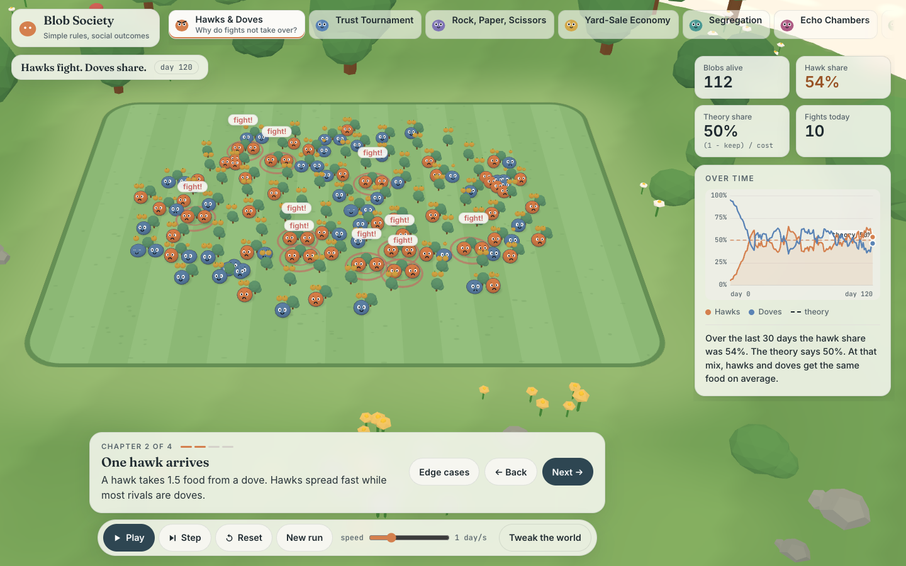
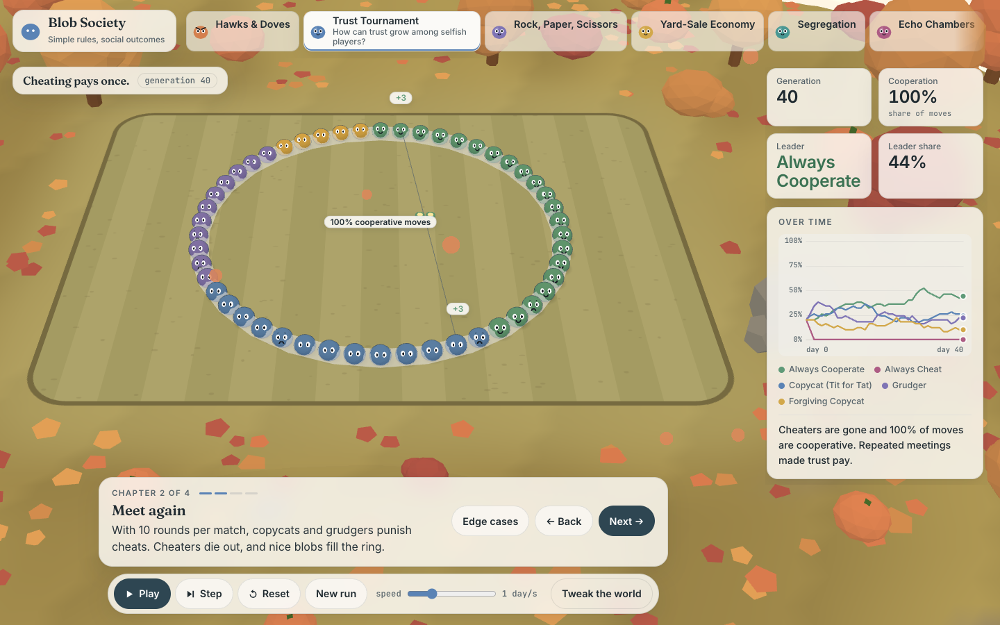
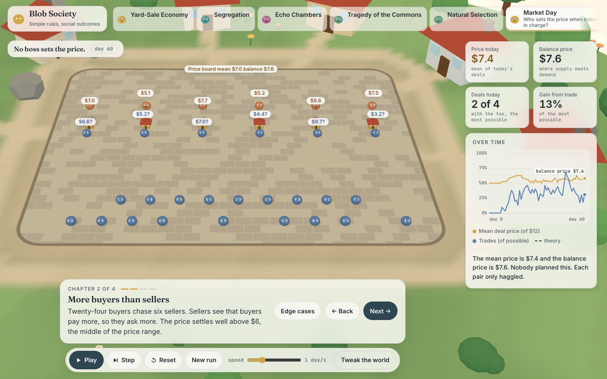
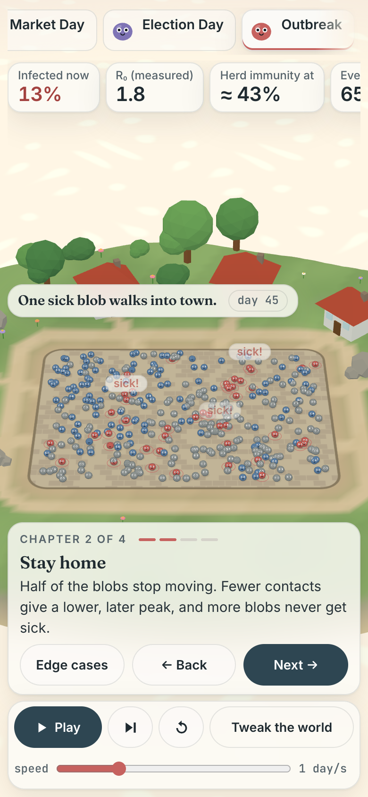

# Blob Society

Small 3D island worlds where simple blobs follow two or three rules, and social patterns appear: fights that stop at a fixed share, trust that needs repeat meetings, inequality from fair coin flips, segregation from mild preferences, echo chambers, the tragedy of the commons, natural selection, markets, elections and epidemics.

Each world has a four-chapter story and 1 to 3 edge-case presets (for example "Free fights", "All-in bets", "Hard lockdown"). Every chapter claim and every preset note is checked by automated model tests over several random seeds, so the text cannot drift away from what the model does.



Inspired by [Primer](https://www.youtube.com/@PrimerBlobs) and Nicky Case's [The Evolution of Trust](https://ncase.me/trust/). This is independent work and is not affiliated with either.

## Worlds

| World | Question | Model |
|---|---|---|
| Hawks & Doves | Why do fights not take over? | Hawk–dove game, ESS share (1 − keep) / cost |
| Trust Tournament | How can trust grow among selfish players? | Iterated prisoner's dilemma, round robin + imitation |
| Rock, Paper, Scissors | What happens when no type is best? | May–Leonard cyclic competition on a lattice |
| Yard-Sale Economy | Can fair coin-flip trades make extreme inequality? | Yard-sale wealth exchange with tax and bias |
| Segregation | How do mild preferences split a city? | Schelling (1971) |
| Echo Chambers | Why do groups split into camps? | Deffuant bounded-confidence opinions |
| Tragedy of the Commons | Why do shared fish stocks collapse? | Logistic fishery with imitation (Gordon–Schaefer) |
| Natural Selection | Which body wins: fast, big or sharp-eyed? | Foraging with heritable speed, size, sense and an energy cost |
| Market Day | How does a fair price appear with no boss? | Random-matching double auction with tax and price cap |
| Election Day | Does the counting method choose the winner? | Spatial voting: plurality, instant runoff, approval |
| Outbreak | When does a disease die out or stay? | Agent-based SIR with vaccination and waning |

## Run it

No build step. Serve the `app/` folder with any static server:

```sh
cd app && python3 -m http.server 8000  # open http://localhost:8000
```

## Test it

```sh
npm install            # only puppeteer-core, for the browser test
npm test               # model claim checks (Node only, about 3 s)
npm run test:browser   # headless Chrome: errors, layout at 3 widths x 2 themes, chapter/knob sync
```

`npm test` writes [`app/tests/RESULTS.md`](app/tests/RESULTS.md): every claim, pass or fail, with the measured values per seed. The browser test looks for Chrome or Chromium in the usual places on macOS, Linux and Windows; set `CHROME` to the browser's path if yours is elsewhere. `SIMS=trust,market` limits it to some worlds, and the full run takes several minutes.

## How the science is checked

- Each chapter's story text makes a claim, for example "the hawk share settles at 50 %" or "with 70 % vaccinated the outbreak fizzles".
- A test runs that chapter's settings for 3 random seeds and checks the claim against a threshold.
- When a claim failed, the text was changed to match the model, not the other way round. Example: the forgiving-copycat "wins with mistakes" story did not hold, so that chapter now tells the "too nice invites cheaters" story, which holds in every seed.
- Mutation guards: tests that fail if a parameter (such as the dove's kept food) stops having its effect.
- Edge-case presets: `app/tests/model_presets.test.js` checks each preset's note (for example "Hard lockdown: peak below 6 %, under 25 % ever infected").

These are stylized models for learning, not forecasts.

## Layout

```
app/index.html         page shell
app/css/app.css        styles and colour tokens (light and dark)
app/js/engine.js       seeded random numbers, helpers, chart
app/js/world.js        three.js island and the render API used by every sim
app/js/sims/<id>.js    one file per world: knobs, chapters, model, metrics, render
app/js/app.js          UI shell: picker, story, knobs, play loop, long-run catcher
app/tests/             model claim tests and the headless browser test
app/tools/             parameter sweeps used to set chapter values
docs/ADDING_A_WORLD.md the world contract and rules for adding a new one
docs/scope.html        the original scope of 20 candidate worlds
```

## Screenshots

| Trust Tournament | Market Day | Phone |
|---|---|---|
|  |  |  |

## Licence

MIT. See [LICENSE](LICENSE).
